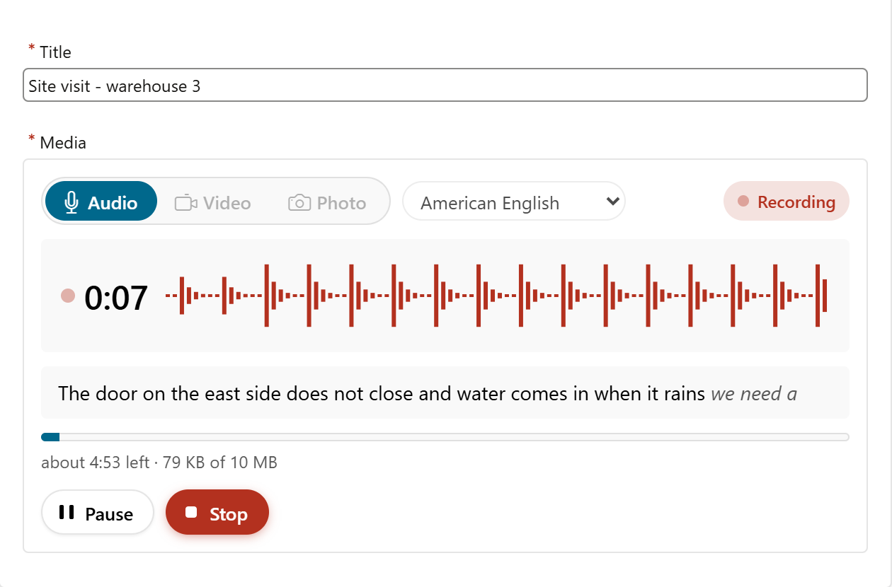
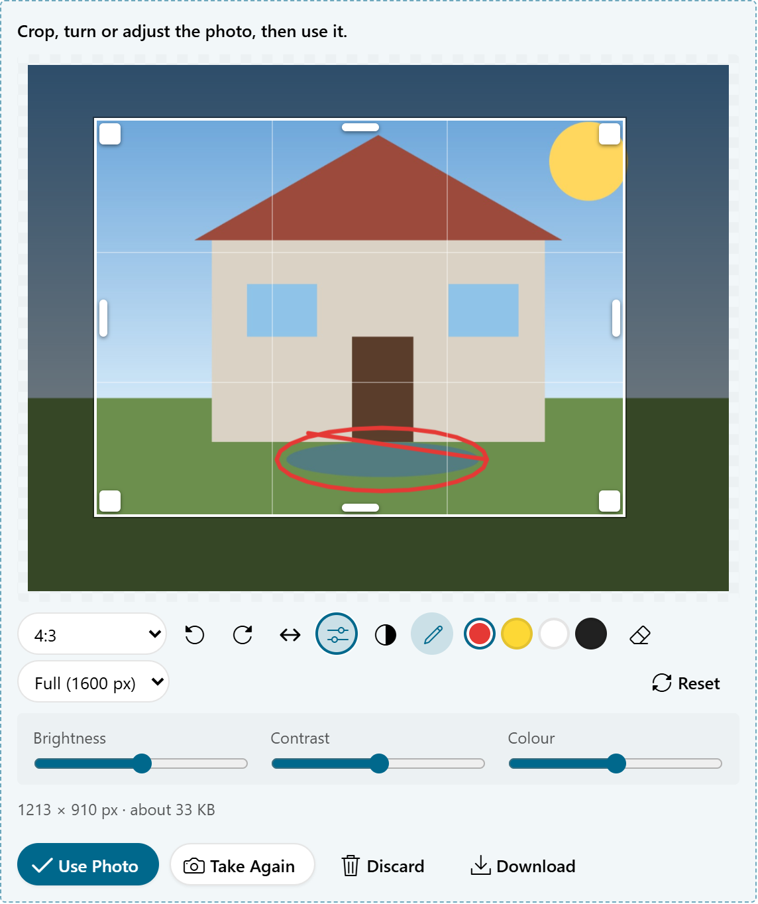
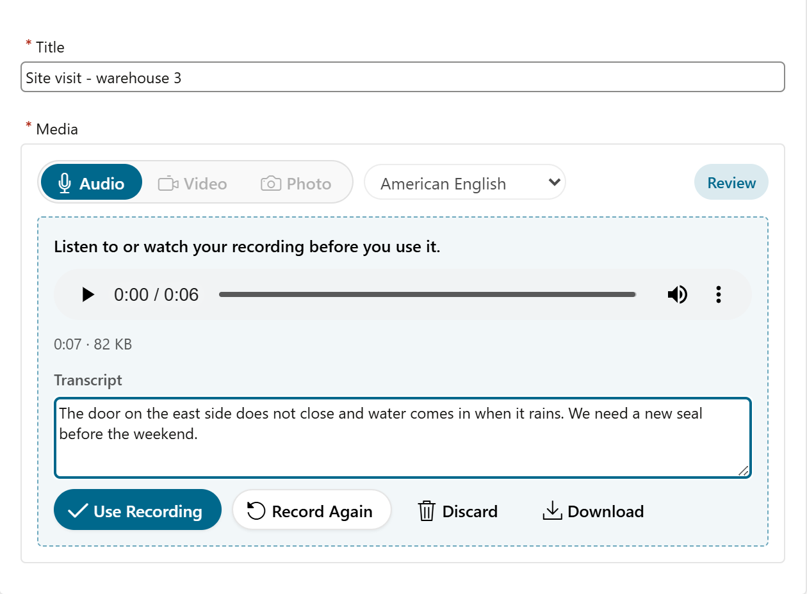

# MediaPlus for Oracle APEX

[](https://apex.oracle.com) [](LICENSE) [](CHANGELOG.md)

An item plug-in that **records audio and video and takes photos** in the page, on phones and desktops. Choose any one, two or all three; with more than one, users pick with a switch.



| Photo editor | Review before use |
|---|---|
|  |  |

**[Live demo](https://oracleapex.com/ords/r/hashaam-admin/apex-plugins-by-hbs/mediaplus)** (demo / Demo@2026) · [Install](#install) · [Photos](#photos) · [Save into your table](#save-into-your-table) · [JavaScript](#javascript) · [Changelog](CHANGELOG.md) · [Issues](https://github.com/HashaamShoukat/apex-plugin-mediaplus/issues)

- **Recordings:** record, pause, resume and stop, then listen to or watch the recording before using it. The item warns early and stops by itself at the size or length limit. Every recording is repaired after recording, so it plays and **seeks in Windows Media Player (also legacy), VLC and on phones**.
- **Photos:** take one with the camera or choose a file, then **crop, rotate, flip, adjust, draw on it and choose the size**. The photo is saved as JPEG, WebP or PNG and compressed until it fits the Maximum File Size.
- Everything waits in an **APEX collection** until your page process saves it into your own table.

No tables or packages to install. APEX 24.1 or later. (Optional: `db/mediaplus_pkg.sql` creates the same PL/SQL as a package, for faster pages; then set the plug-in's callbacks to `mediaplus_pkg.render`, `.ajax` and `.validation` and clear its PL/SQL Code.)

## Install

Import `plugin/item_type_plugin_com_hashaam_mediaplus.sql` (APEX 26.1) or `plugin/item_type_plugin_com_hashaam_mediaplus_24.1.sql` (APEX 24.1 to 25.x) under Shared Components › Plug-ins - both are also attached to the [release](https://github.com/HashaamShoukat/apex-plugin-mediaplus/releases). Then add a page item of type **MediaPlus**. The camera and microphone need the page to be served over **https**.

## Settings

| Group | Setting | What it does |
|---|---|---|
| Capture | **Mode** | Audio, Video, Photo - tick one, two or all three |
| | **Maximum File Size** (MB) | Recordings: live meter, recording stops just before the limit. Photos: compressed until they fit. Checked again on the server |
| | Warning Threshold (%) | Warning ("recording stops soon"), red meter, phone vibration, *Size or Length Warning* event |
| | Maximum Length (s) | Optional time limit for recordings; pauses do not count |
| | Maximum Files | Recordings and photos per item, e.g. 3 photos of a damage |
| Audio and Video Quality | **Quality** | Small Files / Balanced / High Quality / Custom |
| | Audio Bit Rate, Video Resolution, Video Bit Rate, Frame Rate | For Custom |
| | Audio Options | Mono, Noise Suppression, Echo Cancellation, Automatic Gain, Sound in Video Recordings |
| | File Format | **Automatic**: MP4 video and M4A audio, which open everywhere (iPhone, Windows Media Player, Android); or Smallest (WebM) |
| Photo | **Image Format** | JPEG, WebP (25-30% smaller; falls back to JPEG where the browser cannot write it) or PNG |
| | Image Quality (%) | JPEG / WebP quality, default 85 |
| | **Maximum Photo Size** (px) | Longest side of a saved photo, default 1920 |
| | **Editing Tools** | Crop, Rotate, Flip, Adjust, Draw, Resize |
| | Crop Shape | Free (users choose), or a fixed 1:1, 4:3, 3:4, 16:9 or 9:16 - e.g. square profile pictures |
| Controls | Features | Pause and Resume, Review Before Use, Countdown, Level Meter, Switch Camera, Mirror Front Camera, Choose a File, Download, Confirm Delete |
| | Camera | Back or front camera first (video and photos) |
| | Display Style | Standard, or Compact (slim voice-note bar) |
| | Button Style | Rounded (the plug-in's own buttons) or Theme (Universal Theme `t-Button`) |
| | Allow Submit for Requests | Requests that may submit the page while something is unfinished; default `CANCEL,DELETE` |
| Transcription | Transcription | For audio: None; Live (browser speech recognition while users speak); or Server (your own PL/SQL) |
| | Languages | **English (US)**, **Arabic**, or both (users pick; the choice is remembered) |
| | Transcript Item | A page item that receives the transcripts, so users can edit them and submit them with the page. Text the user has changed is never overwritten; new transcripts are added below it |
| | Transcription Code | For Server: PL/SQL that sets `:TRANSCRIPT` |
| Storage | Collection Name | Default `MEDIAPLUS` |
| | File Name | `#ITEM#`, `#TIMESTAMP#`, `#KIND#`, `#N#`; the extension is added for you |
| | Saved Files Query | Recordings and photos already in your table, with play / view and download buttons |

Approximate size per minute for each recording preset:

| Preset | Audio | Video |
|---|---|---|
| Small | 24 kbps, 0.2 MB | 360p, 15 fps, 350 kbps, 2.8 MB |
| Balanced | 48 kbps, 0.35 MB | 480p, 24 fps, 900 kbps, 7 MB |
| High | 128 kbps, 1 MB | 720p, 30 fps, 2.5 Mbps, 19 MB |

## Photos

1. **Take Photo** opens the camera (back camera on phones, 4:3, as sharp as Maximum Photo Size needs); **Capture** takes the picture. Or **Choose File** - a large photo is fine, it is made smaller.
2. The editor shows the photo with a crop box. Depending on Editing Tools:
   - **Crop** - drag the box or its handles; pick Free, 1:1, 4:3, 3:4, 16:9, 9:16 or Whole Photo. Keyboard: arrows move the box, Shift + arrows resize it. A fixed Crop Shape always applies.
   - **Rotate** left / right, **Flip** left - right (the crop turns with the photo).
   - **Adjust** - brightness, contrast, colour, and Black and White.
   - **Draw** - mark things in red, yellow, white or black; Undo.
   - **Resize** - choose a smaller size than Maximum Photo Size.
   - The size of the result (pixels, and about how many KB) is shown under the photo.
3. **Use Photo** saves it: rendered at the chosen size and compressed - quality is lowered (to 50%) and then the size (by 20% at a time) until it fits the Maximum File Size. Re-saving removes EXIF data such as the location. **Take Again**, **Discard** and **Download** (the edited photo) work as for recordings.

Without any Editing Tool and without Review Before Use, a photo is saved as soon as it is taken - still resized and compressed.

## Save into your table

As soon as the user uses a recording or photo, the plug-in uploads it in parts of 1.5 MB, three at a time. It is stored as one member of the collection. The item value is the colon-separated list of the members' SEQ_IDs:

```sql
insert into my_media (request_id, media_kind, media, mime_type, file_name, file_size, duration_sec, width_px, height_px, transcript)
select :P10_REQUEST_ID, c003, blob001, c002, c001, n001, n002, n003, n004, clob001
  from apex_collections
 where collection_name = 'MEDIAPLUS'
   and seq_id in (select column_value from table(apex_string.split_numbers(:P10_MEDIA, ':')));

-- optional: free the collection now (members nobody saved are removed after an hour)
for r in (select column_value as seq_id from table(apex_string.split_numbers(:P10_MEDIA, ':'))) loop
    apex_collection.delete_member('MEDIAPLUS', r.seq_id);
end loop;
```

| Column | Holds |
|---|---|
| BLOB001 | The recording or photo |
| C001 / C002 / C003 | File name / MIME type / `AUDIO`, `VIDEO` or `IMAGE` |
| C004 | Item name |
| N001 / N002 | Size in bytes / length in seconds (recordings) |
| N003 / N004 | Width / height in pixels (photos) |
| D001 | Added at |
| CLOB001 | Transcript, when Transcription is Live or Server |

## Transcription

With **Transcription = Live**, audio recordings are transcribed while users speak, using the browser's speech recognition (Web Speech API), in **English (US) or Arabic**.
- **Browsers:** Chrome, Edge and Safari. Chrome sends the audio to Google's speech service. Firefox has no speech recognition.
- **While recording:** the text appears under the waveform.
- **In Review Before Use:** users can correct the text, or type it when nothing was recognised.
- **Where it goes:** the transcript is saved in CLOB001, sent in the *Media Saved* event, and, if a **Transcript Item** is set, written into that page item.
- **Saved recordings:** show their transcript when the Saved Files Query returns it as a 5th column.

With **Transcription = Server**, your **Transcription Code** runs on the server when an audio recording is saved, so it works in every browser, Firefox included. Use it to call a speech service (OCI Speech, Azure, Whisper, ...). It receives these binds:

| Bind | Value |
|---|---|
| `:COLLECTION_NAME`, `:SEQ_ID` | Where the recording is; read it with `select blob001 from apex_collections where collection_name = :COLLECTION_NAME and seq_id = :SEQ_ID` |
| `:MIME_TYPE` | For example `audio/webm` |
| `:LANGUAGE` | `en-US` or `ar-SA` |
| `:TRANSCRIPT` | Set it to the text (up to 32767 characters) |

```sql
declare
    l_media blob;
begin
    select blob001 into l_media from apex_collections
     where collection_name = :COLLECTION_NAME and seq_id = :SEQ_ID;
    :TRANSCRIPT := my_speech_pkg.transcribe(l_media, :MIME_TYPE, :LANGUAGE);
end;
```

If the code fails, the recording is still saved, without a transcript (the error goes to the debug log).

## Limits, checks and recovery

- **The server checks every limit again**: Maximum File Size (+3% for the estimated MP4 meter), Maximum Files, the Mode, and the file content - the first bytes must be WebM, MP4, Ogg, WAV, MP3, FLAC or AMR for recordings and JPEG, PNG, WebP, GIF or HEIC for photos, not only the MIME type. At most 3 uploads run per item and session; unfinished uploads (`<collection>$PARTS`) are removed after an hour.
- **Nothing is lost.** A recording or photo that has not been used yet is kept in the browser (IndexedDB, 7 days). After a reload, a crash or a lost connection, it comes back for review. When saving fails, it stays, **Use** becomes **Try Again**, and **Download** is offered. When the session has ended, the user is told to download it first.
- **Too large after recording** (rare, for estimated MP4 sizes): the recording is kept for download, not discarded.
- **Microphone or camera lost** (a call, the screen locking, a device unplugged): recording stops and what was recorded is kept.
- **Keyboard:** P pauses and resumes, S stops, while the item has focus. Notices are read out by screen readers.

**Value Required** works as usual. While a recording is running, or a recording or photo waits to be used, the page cannot be submitted; the user sees a message instead. Requests in **Allow Submit for Requests** (for example Cancel and Delete buttons) still submit. The item's **validation** also rejects SEQ_IDs that are no longer in the collection, and more files than Maximum Files.

## Show saved files

Set **Saved Files Query**. List the BLOB first, then optionally the MIME type, file name and length in seconds:

```sql
select media, mime_type, file_name, duration_sec from my_media where request_id = :P10_REQUEST_ID
```

Recordings get a player, photos a viewer. Make the item **read-only** if users should only see them. Playback downloads the whole file once, so it also works on Safari, which cannot stream media without byte-range support.

## Events

Dynamic action events on the item, with details in `this.data`:

| Event | `this.data` |
|---|---|
| Recording Started | kind, mimeType |
| Recording Paused / Resumed | seconds |
| Recording Stopped | bytes, seconds, mimeType |
| Size or Length Warning | bytes, seconds, maxBytes, maxDuration; or reason `nosound` |
| Limit Reached | reason (`size` / `duration`), bytes, seconds |
| Photo Taken | width, height (of the camera picture) |
| Media Saved | seq, name, mimeType, kind, bytes, seconds, width, height, transcript |
| Media Discarded / Deleted | seq, name |
| Media Error | reason, message |

## JavaScript

```js
var m = mediaPlus.get("P10_MEDIA");
m.kind("image");   // switch to audio / video / image (no argument: the current one)
m.start();         // open the camera / start recording
m.capture();       // take the photo (camera open)
m.pause(); m.resume(); m.stop();
m.use(); m.discard();
m.state();         // idle, opening, ready, countdown, recording, paused, stopping, review, uploading
m.isBusy();
m.recordings();    // [{ seq, name, mimeType, kind, bytes, seconds, width, height, transcript }]
```

`apex.item("P10_MEDIA")` supports getValue, setValue (keeps only the SEQ_IDs you pass), isChanged, enable and disable. The **Initialization JavaScript Function** can change any option:

```js
function (options) {
    options.maxBytes = 3 * 1048576;
    options.texts = { TAKE_PHOTO: "Photograph the meter" };
    return options;
}
```

`mediaPlus.fixMp4(blob)` and `mediaPlus.fixWebm(blob)` are available to repair other MediaRecorder files.

## Translate

Create application text messages named `MEDIAPLUS.<KEY>`. Keys:
AUDIO, VIDEO, IMAGE, KINDS, RECORD, TAKE_PHOTO, CAPTURE, USE_PHOTO, RETAKE, PHOTO_TITLE, ROTATE_LEFT, ROTATE_RIGHT, FLIP, CROP, CROP_FREE, CROP_ALL, ADJUST, BRIGHTNESS, CONTRAST, SATURATION, GRAYSCALE, DRAW, UNDO, RESET, SIZE, SIZE_FULL (%0 px), SIZE_PX (%0), PHOTO_META (%0 width, %1 height), PHOTO_SIZE (%0), PREPARING, PHOTO_FAILED (%0 reason), PHOTO_TOO_LARGE (%0 maximum), VIEW, HIDE, OPEN_CAMERA, START, PAUSE, RESUME, STOP, CANCEL, CLOSE_CAMERA, SWITCH_CAMERA, CHOOSE_FILE, DEVICE_RECORDER, USE, RETRY, AGAIN, DISCARD, DOWNLOAD, PLAY, HIDE_PLAYER, DELETE, READY, RECORDING, PAUSED, REVIEW, UPLOADING, STARTING, FINISHING, SAVED, PENDING, TRANSCRIBING_SERVER, REVIEW_TITLE, UPLOAD_PROGRESS (%0 = percent), LIMIT_HINT (%0 size), LIMIT_HINT_TIME (%0 size, %1 length), CAPACITY, METER (%0 time left, %1 size, %2 maximum), OF, WARN_SIZE, WARN_TIME, STOPPED_SIZE, STOPPED_TIME, DEVICE_ENDED, MAX_COUNT, MAX_COUNT_ONE, FILE_TOO_LARGE, TOO_LARGE_KEEP, FILE_WRONG_TYPE, NO_PERMISSION, NO_DEVICE, NOT_SUPPORTED, BUSY, CONFIRM_DELETE, CONFIRM_DISCARD, UPLOAD_FAILED (%0 = reason), NETWORK, SESSION_ENDED, RECOVERED, PLAY_FAILED, TRANSCRIPT, TRANSCRIPT_LANGUAGE, TRANSCRIPT_PLACEHOLDER, TRANSCRIBING, STT_UNSUPPORTED, STT_FAILED, KEYS, NO_SOUND.
The server messages are TOO_LARGE, WRONG_TYPE, UPLOAD_INCOMPLETE, BUSY_UPLOADS, MAX_COUNT, SERVER_ERROR, EXPIRED and TOO_MANY. Right-to-left languages are supported.

## Good to know

- **Formats.** With File Format = Automatic, Chrome, Edge and Safari record video as MP4 (H.264/AAC) and audio as M4A (AAC), which open on iPhones, Macs, Windows Media Player and Android. Firefox cannot write MP4 and records WebM. No browser can record MP3. AAC gets at least 96 kbps (Chrome records it at about 100 kbps anyway), about 0.75 MB per minute; Smallest (WebM) is about a quarter of that for speech but WebM files do not open on iPhones or in Windows Media Player. The real type is saved with every recording.
- **No sound.** If nothing reaches the recording for 3.5 seconds - or the system mutes the microphone (a call, AirPods taken over by another app) - users are warned while they record (text NO_SOUND, *Size or Length Warning* event with reason `nosound`).
- **Sound quality.** Echo Cancellation switches iPhone microphones to phone-call quality - leave it off unless sound plays while recording. Bluetooth headsets (AirPods) always record in phone-call quality.
- **Switch Camera** is shown once the camera is open and the device has more than one (Safari lists all cameras only after permission).
- **MP4 repair.** Chrome and Edge write fragmented MP4 with a duration of 0 in longer recordings, so Windows Media Player shows no length and cannot seek. After recording, the plug-in rewrites it as a regular MP4 - full sample tables (keyframes, sizes, timing) before one data block, correct durations (`mediaPlus.fixMp4(blob)`). Checked with Windows Media Player (modern and legacy engine): seeking works.
- **WebM repair.** MediaRecorder writes "live" WebM without Duration, with clusters of unknown size and no Cues. The plug-in rewrites it with the Duration, sized clusters, a SeekHead and Cues on keyframe clusters (`mediaPlus.fixWebm(blob)`).
- **Size meter.** Chrome delivers MP4 data only now and then. While recording, the meter therefore estimates the size from the bit rate, so the size limit stays safe and may stop slightly early.
- **Photo orientation.** Photos from phones are turned the right way up (EXIF orientation) before editing.
- Without https, or in a browser that cannot use the camera, the item offers the phone's own camera or recorder through a file picker.
- Colours come from Universal Theme variables, so Theme Roller styles and dark mode apply.

## Build

`npm install && npm run build` copies `src/` to `dist/` (plain and minified) and writes `dist/plugin.apx` (the APEXlang plug-in definition, with the PL/SQL from `src/mediaplus.plsql` and a content hash on the file URLs) and `db/mediaplus_pkg.sql`. With `APEX_APP_DIR` set to an APEXlang application folder, the static files and `plugin.apx` are written into it too.

`qa/` has file tools: `node qa/inspect.js <file>` (MP4 / WebM structure), `node qa/boxes.js <file.mp4>` (MP4 boxes and sample tables), `node qa/fixtest.js <file>` (runs the MP4 / WebM repair), `node qa/verify-webm.js <file.webm>`.

MIT License (c) 2026 Hashaam Shoukat
